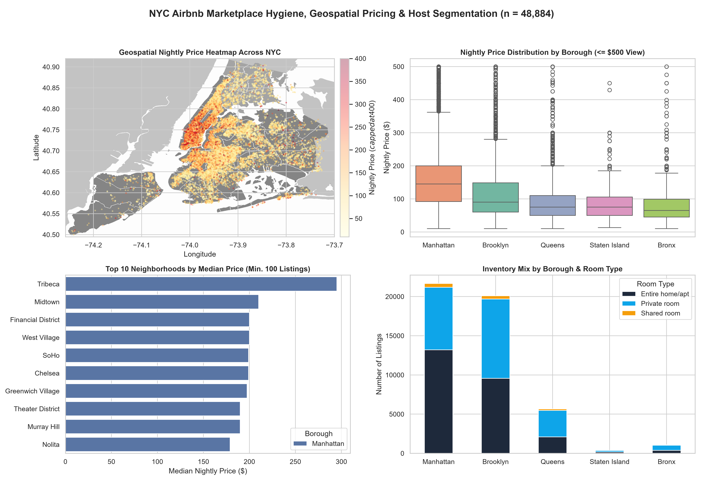

# NYC Airbnb Marketplace Hygiene, Geospatial Pricing & Host Segmentation

End-to-end data auditing, policy-driven cleaning, geospatial mapping, and non-parametric statistical analysis of **48,895 NYC Airbnb listings** using **Python (`Pandas`, `NumPy`, `SciPy`, `Matplotlib`, `Seaborn`, `Pillow`)**.

## Executive Visual Summary

## Data Hygiene & Debugging Log ("Gotchas" Resolved)
Rather than blindly calling `.dropna()`, every anomaly in the raw dataset was audited and resolved with documented business rules:
1. **Structural Missingness (`10,052` nulls in `reviews_per_month` & `last_review`):** Verified that 100% of these nulls occur when `number_of_reviews == 0`. Imputed `reviews_per_month = 0.0` and engineered a `has_reviews` flag to preserve **20.6%** of NYC's unreviewed inventory.
2. **Corrupted `$0/Night` Listings (`11` rows):** Discovered 10 of 11 `$0` listings had active review histories (up to `95` reviews), confirming scraper corruption rather than free stays. Removed only those 11 records (`48,895 -> 48,884`).
3. **Extreme `minimum_nights` Outliers (`14` rows `> 365` nights, max `1,250`):** Segmented listings at NYC's 30-day statutory threshold (`Short-Term <30 Nights` vs. `Long-Term 30+ Nights`) and capped extreme values at `365`.
4. **Asset Binary-Header Mismatch (`New_York_City_.png`):** `matplotlib.image.imread()` threw `SyntaxError: not a PNG file` because the file carried non-PNG binary headers under a `.png` extension. Resolved by decoding raw image bytes via `PIL.Image.open().convert("RGB")`.

## Key Analytical Findings
1. **Severe Right-Skew Demands Medians Over Means:** Luxury outliers (up to `$10,000/night`) inflate Manhattan's mean to **$196.88** vs. a true median of **$150.00** (Brooklyn: **$124.44** mean vs. **$90.00** median; Kruskal-Wallis $H = 7023.12, p < 0.001$).
2. **Commercial Operator Footprint:** Multi-listing commercial operators account for **33.92%** (`16,583` listings) of NYC supply at a lower median rate (**$93.00**) than single-listing hosts (**$119.00**, Mann-Whitney $p < 0.001$), led by `Sonder (NYC)` (`327` listings) and `Blueground` (`232` listings).
3. **NYC 30-Day Rental Bifurcation:** Long-term (`30+ nights`) listings command a higher median nightly rate (**$130.00**) than short-term (`<30 nights`) stays (**$100.00**, $p < 0.001$).
4. **Neighborhood Concentration:** All top 10 most expensive neighborhoods (minimum 100 listings) sit in **Manhattan**, led by **Tribeca ($295 median)**, **Midtown ($210)**, and **Financial District / West Village ($200)**.
